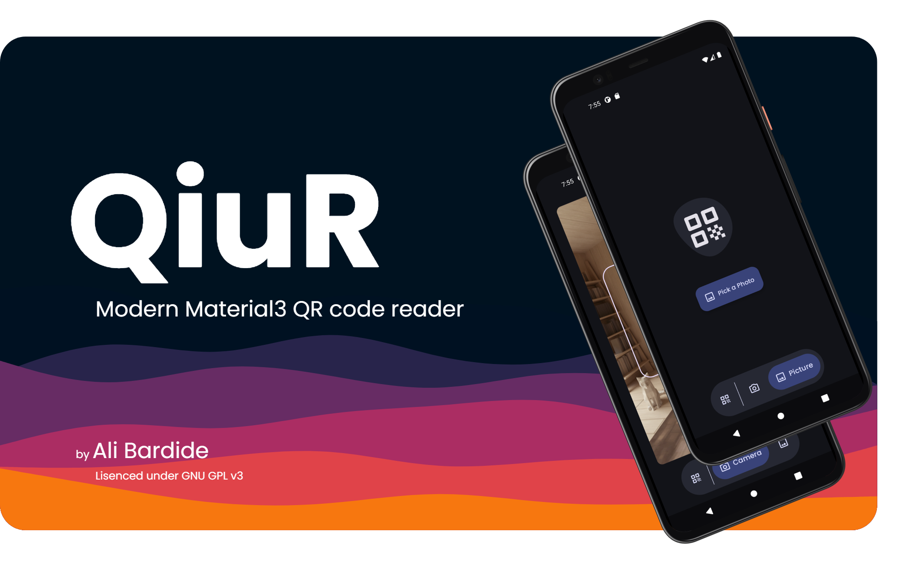
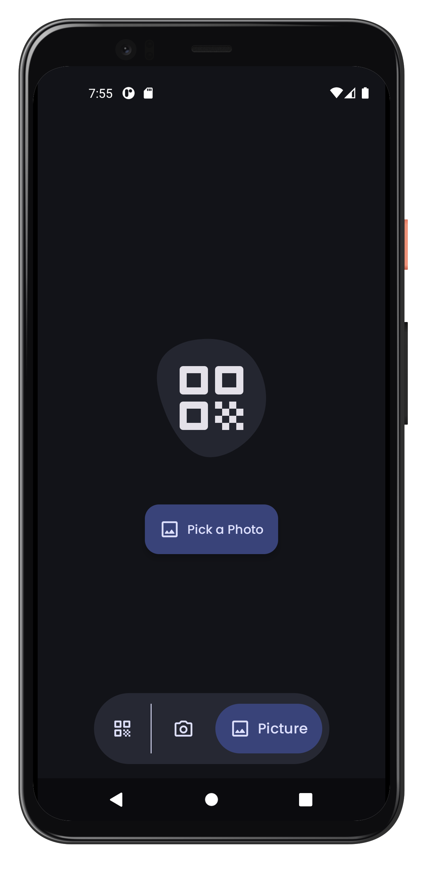
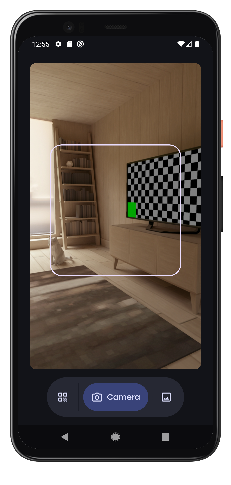
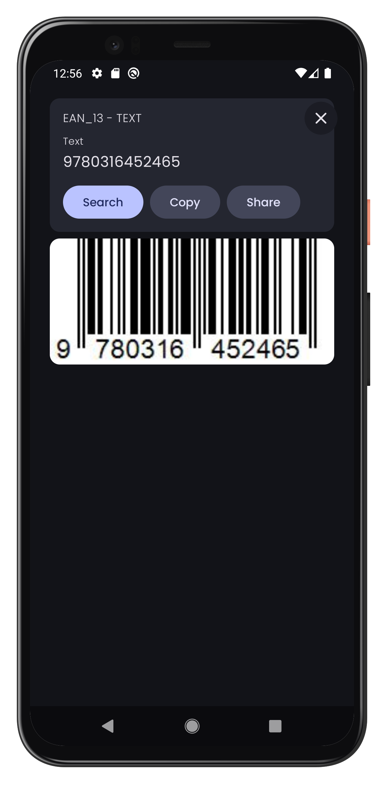
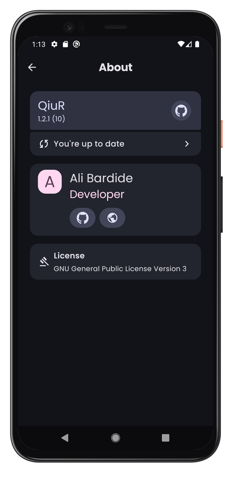

# QiuR - Scan QR with ease

QiuR is an adnroid app that scan QR, or barcodes. Simple as that. With new material3 design you can use this app and don't worry about your privacy. If you don't like to use your camera, you're free not to.

To download, you can checkout [latest release](https://github.com/alibardide-dev/QiuR/releases/latest) of QiuR


# Screenshots

<div style="width:100%; display:flex; justify-content:space-between;">

[](docs/screenshot_1.jpg)
[](docs/screenshot_2.jpg)
[](docs/screenshot_3.jpg)
[](docs/screenshot_4.jpg)
[](docs/screenshot_5.jpg)

</div>

# Features

- [X] Scan from pictures
- [X] Scan with camera
- [X] Smooth UI
- [X] In-app updater
- [X] History
- [ ] Create QR codes

# Tech Stack

- Kotlin for programming android application
- Jetpack compose to design declarative android ui
- Koin for dependency injection
- DataStore to save data
- CameraX for... camera
- zxing for scanning codes
- QRose for generating QR / Barcode
- Material3 design

# Repo Structure

```
├── app/src/main/
│   ├── java/com/phoenix/booklet/
│   │   ├── data/ # Handle data related tasks (Network, Local) 
│   │   ├── di/ AppModule.kt
│   │   ├── screen/ # Directory which stores application screens
│   │   │   ├── about/...
│   │   │   ├── home/...
│   │   │   ├── AppNavigation.kt
│   │   ├── ui/theme/
│   │   ├── utils/
│   │   │   ├  BitmapUtils.kt
│   │   │   ├  Constants.kt
│   │   │   ├  DateUtils.kt
│   │   │   ├  ScanUtils.kt
│   │   │   ├  UpdateHandler.kt
│   │   │   ├  WifiUtils.kt
│   │   ├   BaseApplication
│   │   ├   MainActivity.kt
│   ├── res/ # Resources
│   │   ├── drawable/
│   │   ├── mipmap/
│   │   ├── ...
│   ├   AndroidManifest.xml/
├── gradle/
│   └── ...
├── LICENSE
└── README.md
```

# Setup

- Clone reposity by running git clone `https://github.com/alibardide-dev/QiuR`
- Install Android Studio and Android SDK
- Build project with Ctrl + F9
- Install Virtual Machine or connect a Physical Device
- Run using Shift + F10

# Support

If you like this application, just support it by joining [stargazers](https://github.com/alibardide-dev/QiuR/stargazers) for this repository \
And [follow me](https://github.com/alibardide-dev?tab=followers) for my next projects

# License

QiuR by [Ali Bardide](https://github.com/alibardide-dev) is licensed under a [GNU GPL v3 License](https://www.gnu.org/licenses/gpl-3.0.en.html).